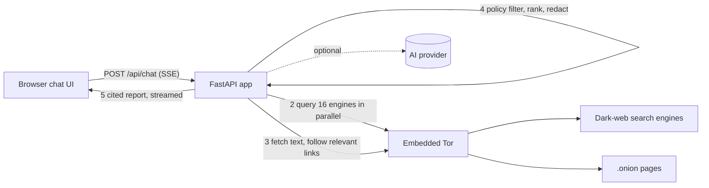

VOID-Dark Web AI OSINT
(NOTE: This is still work in development and some features might not work properly.)

**By Aniket Misra**

(https://github.com/OWNER/void/actions/workflows/ci.yml/badge.svg)](https://github.com/OWNER/void/actions/workflows/ci.yml)
(https://img.shields.io/badge/license-MIT-blue.svg)]

A **passive, defensive dark web OSINT assistant** with a ChatGPT-style interface. Ask a question in
plain English; Void searches **16 dark-web search engines at once** through its own built-in Tor,
reads the matching pages and follows relevant links one hop further, then writes a **cited
threat-intelligence report on its own**. No AI key, no model download and no Tor Browser are needed.

Optionally, connect an AI (OpenAI/ChatGPT API, Anthropic, Gemini, OpenRouter, Groq, Mistral, any
OpenAI-compatible server, or a local Ollama model) for fluent narrative summaries and follow-up chat.
The design follows the open-source [Robin](https://github.com/apurvsinghgautam/robin) project (many
engines in parallel, Tor-only fetching, text-only scraping), but works without a language model.

Typical uses: brand-exposure monitoring, leaked-credential checks for your own domains, ransomware
and threat-actor chatter, sector threat briefings.

> **Passive research only.** Void never logs in, registers, buys, posts or downloads files.
> It refuses queries involving child sexual exploitation or acquiring illegal goods. See
> [Safety design](#safety-design) and [SECURITY.md](SECURITY.md).

> **About "the entire dark web":** no tool can scrape all of it. Most hidden services are unindexed,
> private or behind logins, and many engines are offline at any moment. Void queries every
> engine in its list in parallel, merges and ranks the answers, and crawls one hop of relevant links,
> and every report states how many engines answered. That is broad coverage of the *indexed* dark web,
> not all of it.

## Quick start

Requirements: Docker with the Compose plugin on Linux. That is all.

```bash
git clone https://github.com/OWNER/void.git && cd void
make up            # builds and starts Void (includes its own Tor)
```

Open **http://localhost:8000** and ask a question. The **Tor** badge shows start-up progress and turns
green after about a minute on the first start. There is nothing to configure.

```bash
make logs          # follow logs
make down          # stop
```

### Without Docker

```bash
sudo apt update && sudo apt upgrade -y  # Run a system upgrade
sudo apt install tor python3-venv      # the tor package only; you do not need to start it
tor                                    # Bootstrap the terminal
make install                           # virtualenv + Python dependencies
make run                               # http://127.0.0.1:8000
```

Void launches and manages its own Tor process on a free local port. If you would rather use an
existing Tor, set `TOR_PROXY=socks5h://127.0.0.1:9050`.

### Optional: add an AI

Click **AI model (optional)** in the sidebar, pick a provider, enter the exact model ID from the
provider's documentation, paste your key and press **Save & test**. The key is stored on the server
(mode 0600) and never sent back to the browser. Or set `LLM_PROVIDER`, `LLM_MODEL` and
`OPENAI_API_KEY` / `ANTHROPIC_API_KEY` / `LLM_API_KEY` in `.env`.

| Provider | Notes |
| --- | --- |
| Void built-in (default) | Extractive analyst, no key. Cites sources, extracts indicators, scores risk |
| OpenAI (ChatGPT API) | Chat Completions, with automatic fallback to the Responses API |
| Anthropic (Claude) | Messages API |
| Google Gemini, OpenRouter, Groq, Mistral | Through their OpenAI-compatible endpoints |
| Custom | Any OpenAI-compatible server (LM Studio, vLLM, llama.cpp, LiteLLM...) |
| Ollama (optional) | Fully local; start with `make up-local` (about 5 GB, needs about 8 GB RAM) |

If a chosen AI is unconfigured or fails (wrong model name, bad key, no credit), the investigation
still completes with the built-in analyst and says why. With a cloud provider, the redacted page text
and your questions are sent to that provider; use the built-in analyst or a local model to avoid that.

## How it works



1. **Query:** keywords are extracted locally (or by your AI, if configured).
2. **Search:** all engines are queried at once through Tor (`socks5h`, DNS resolved inside Tor).
   Results are deduplicated, ranked by how many engines returned them, and capped per site.
3. **Read and crawl:** top results are fetched as text only (size-capped, no images or downloads, every
   redirect re-validated). Links on those pages whose text or address matches your terms are followed one hop.
4. **Filter, rank, redact:** flagged content is dropped; pages are ranked by relevance; emails, card
   numbers and `password: ...` patterns are masked.
5. **Report:** the built-in analyst writes Summary, Key findings (sentences copied from sources, with
   citations), Indicators (CVEs, hashes, wallets, IPs, onion hosts, named groups), a heuristic Risk
   assessment, Recommended actions and a Confidence section. With an AI configured, the AI writes it instead.

Turn **Search dark web** off to ask follow-ups about earlier results (needs an AI model).

### Networking

The container has ordinary internet access. Search and page requests are forced through the embedded
Tor in code (SOCKS5 with remote DNS, proxy environment variables ignored); calls to an AI provider, if
you configure one, go directly to it. This is not enforced by the network, so do not run untrusted code
in the container. It runs with all Linux capabilities dropped, `no-new-privileges` and a read-only
root filesystem; `/data` (a volume) holds the audit log, Tor state and saved settings.

## Configuration

Set values in `.env` (see [`.env.example`](.env.example)). Everything is optional.

| Variable | Default | Purpose |
| --- | --- | --- |
| `TOR_PROXY` | `auto` | `auto` = Void runs its own Tor. Or `socks5h://host:port` for an existing one |
| `SEARCH_ENGINES` | 16 built-in engines | Comma-separated `name=url_template` pairs; `{query}` is substituted |
| `MAX_RESULTS` / `MAX_FETCH` | `40` / `8` | Unique results kept / pages analysed |
| `CRAWL_LINKS` | `8` | Extra pages reached by following relevant links (`0` turns crawling off) |
| `FETCH_TIMEOUT` | `45` | Seconds per request through Tor |
| `LLM_PROVIDER` / `LLM_MODEL` / `LLM_BASE_URL` | built-in | Optional AI (see above) |
| `LLM_API_KEY` / `OPENAI_API_KEY` / `ANTHROPIC_API_KEY` | *(empty)* | Optional AI key (saved UI settings win) |
| `ALLOW_UI_CONFIG` | `true` | `false` locks the AI settings dialog (shared deployments) |
| `APP_PORT` | `8000` | Host port (bound to 127.0.0.1) |
| `ACCESS_TOKEN` | *(empty)* | If set, the API requires `Authorization: Bearer <token>`. **Set before exposing beyond localhost** |
| `ALLOWED_HOSTS` | *(empty)* | Extra Host names served when no token is set (default: localhost only) |
| `REDACT_PII` | `true` | Mask emails, cards and credentials before analysis |
| `ALLOW_CLEARNET` | `false` | Only `.onion` hosts are fetched unless enabled |
| `MAX_CONCURRENT` | `2` | Parallel investigations (others get HTTP 429) |
| `OLLAMA_MODEL` / `OLLAMA_NUM_CTX` | `llama3.1:8b` / `8192` | Only for the optional local model |

Extra block rules go in [`config/blocklist.txt`](config/blocklist.txt) (one regex per line).

## Safety design

| Risk | Control |
| --- | --- |
| Child-exploitation material | Plain-English query and content filter, extensible via `config/blocklist.txt`; flagged pages are dropped before the LLM, logs and UI. Text-only fetching means images are never retrieved. |
| Facilitating illegal purchases | Query gate for acquisition intent; system prompt forbids operational help. |
| Prompt injection from hostile pages | Pages wrapped in `<untrusted_source>` tags with angle brackets neutralised; the model is given no tools; clients cannot inject `system` turns. |
| Exposure of personal data | Emails masked (domain kept), Luhn-valid card numbers and credential patterns redacted by default. |
| Hostile links | `.onion` URLs are shown defanged and never rendered as clickable links; only v3 onion hosts are fetched; redirects off-allowlist are refused. |
| XSS | Model output is HTML-escaped before a minimal markdown pass; strict CSP (`default-src 'self'`). |
| API key theft (optional AI) | Keys are validated, stored server-side with mode `0600`, never returned by any API (only a `…1234` hint), scrubbed from error messages, and a saved key is dropped if the provider or URL changes. Remote providers must use `https://`; redirects are not followed. |
| Drive-by attacks on a local install | Without a token only localhost Host headers are served (DNS-rebinding defence) and state-changing requests must be same-origin. |
| Misuse / accountability | Append-only audit log of queries and URLs read (never page content) in the `void-data` volume. |

These controls reduce risk but are not a guarantee. Keep a human in the loop and read
[SECURITY.md](SECURITY.md).

## API

`POST /api/chat` with `{"message": str, "history": [{"role": "user|assistant", "content": str}], "search": bool}`
returns a Server-Sent Events stream:

| Event | Data |
| --- | --- |
| `status` | `{step, message}` progress updates |
| `sources` | `{items: [{n, title, url, display, fetched}], more}` |
| `token` | `{text}` incremental answer text |
| `error` | `{message}` |
| `done` | `{refined, sources, model}` or `{blocked: true}` |

Also: `GET /api/status` (Tor and AI readiness: `llm_state` is `ready`, `needs_setup`, `offline` or
`pulling`), `GET /healthz`, and the settings endpoints used by the UI:
`GET /api/settings` (providers and current config, never the key), `PUT /api/settings`
(`{provider, model, base_url, api_key, clear_key}`) and `POST /api/settings/test`.

## Development

```bash
make install       # venv + dev dependencies
make test          # pytest (no Tor, network or API key needed; everything is faked)
make lint          # ruff
```

```
app/            FastAPI app, pipeline, built-in analyst, embedded Tor, search/fetch, AI clients, UI
tests/          unit + API tests with injectable fakes
config/         operator blocklist
.github/        CI, release-to-GHCR, Dependabot
```

## Project status

Version 0.2.0. 172 automated tests cover the pipeline, the built-in analyst, safety filters, URL rules,
multi-engine search and ranking, crawling, the embedded Tor manager, auth, the settings API and each AI
provider's request format (against mocked HTTP). The UI was exercised in headless Chrome with mock engines
and a stand-in `tor` binary.

**Not yet verified:** a live run through the real Tor network and the real engines (so engine
availability and markup are untested), the Docker image build, and the real OpenAI/Anthropic/Gemini
APIs. The engine list is copied from the Robin project; onion addresses change and engines go offline, so
expect some to fail on any given day (the report says how many answered). Search-result parsing is
deliberately generic; if an engine changes its markup, adjust `parse_results` in `app/search.py`.
The built-in analyst is extractive (it quotes and counts); it does not reason or verify claims.

## Troubleshooting

| Symptom | Fix |
| --- | --- |
| "Tor starting… N%" | Normal for the first minute. Stuck? `docker compose logs app` (look for `tor:` lines); some networks block Tor |
| Banner "Tor is not installed" | Without Docker: `sudo apt install tor` |
| "Tor offline" | Tor exited; see logs. It is restarted up to 3 times |
| "Every search engine failed" | Tor still bootstrapping, or engines down/blocking Tor. Details are under *Investigation steps* |
| "Offline or blocked" line under Investigation steps | Normal: some of the 16 engines are always down or block Tor. Only worry if *every* engine fails |
| Few or no results | Normal for narrow queries. Try other keywords or a company/domain name |
| AI error (e.g. "could not find that model") | The model ID is wrong for that provider. The report still completes with the built-in analyst; fix it under *AI model (optional)* |
| HTTP 429 | Another investigation is running; raise `MAX_CONCURRENT` |

## Legal and ethics

Use Void only for lawful, defensive purposes such as monitoring your own organisation's exposure.
Laws on accessing and handling leaked data vary by jurisdiction; check yours and your employer's
policy. If you encounter child sexual abuse material, do not download or share it: report it to the
[NCMEC CyberTipline](https://report.cybertip.org), the [Internet Watch Foundation](https://report.iwf.org.uk)
or your local [INHOPE](https://www.inhope.org) hotline.

